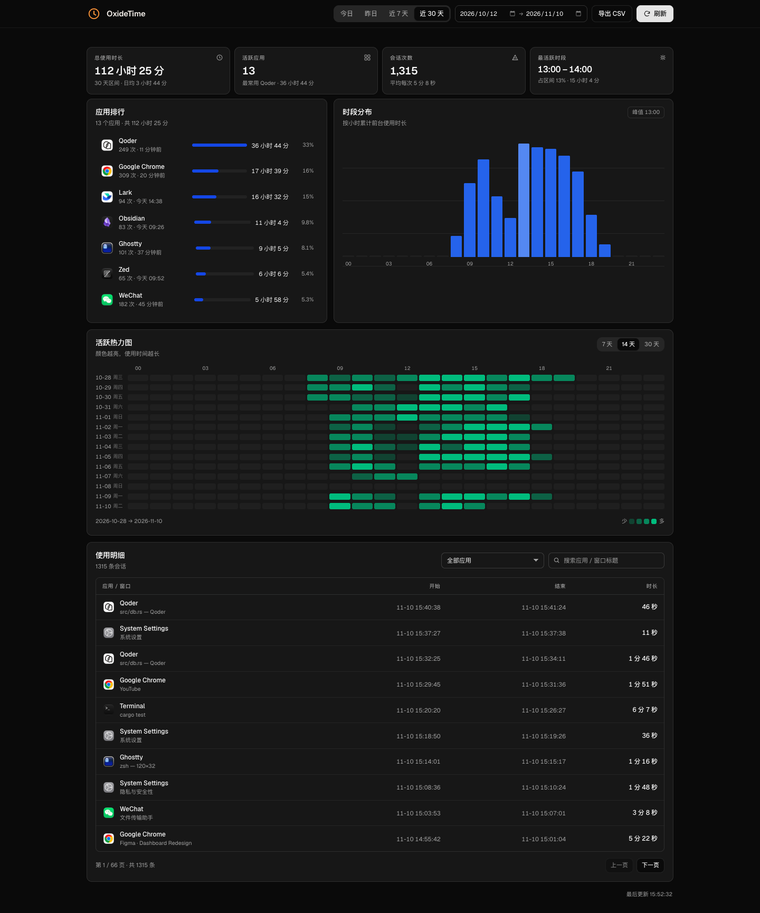

# OxideTime

> macOS 前台应用使用时长追踪 + 本地 Web 看板。单二进制、数据全部留在本机。

OxideTime 每 2 秒采样一次当前前台应用，把使用过程整理成会话写入 SQLite，并通过内置的 Web 看板展示应用排行、时段分布、活跃热力图与可筛选的使用明细。



## 功能

- **前台应用追踪**：AX API 优先识别前台应用，`CGWindowList` 作为兜底，应用切换即时生效
- **窗口标题**：授予辅助功能权限后记录窗口标题（未授权时仅记录应用名与时长）
- **空闲检测**：默认空闲 180 秒后停止计时，避免挂机时间被计入
- **会话化存储**：每 2 秒采样、每 5 秒落盘，切换应用或窗口时切分会话，过短会话自动丢弃
- **看板**
  - 今日 / 昨日 / 近 7 天 / 近 30 天或自定义日期区间
  - 总时长、活跃应用、会话次数、最活跃时段
  - 应用排行（真实应用图标）、24 小时时段分布、7/14/30 天热力图
  - 使用明细：按应用筛选、标题搜索、分页、CSV 导出
  - 响应式布局，桌面与手机均可使用
- **本地优先**：SQLite（WAL）存储在 `~/Library/Application Support/OxideTime`，无账号、无云同步
- **演示模式**：一条命令生成近 N 天虚拟数据，适合截图、演示或体验看板

## 技术栈

| 层 | 选型 |
| --- | --- |
| 语言 | Rust 2024 edition |
| Web | axum 0.8 + tokio |
| 存储 | SQLite（rusqlite，bundled）+ WAL |
| macOS API | objc2 / objc2-app-kit / core-foundation |
| 时间 | chrono（本地时区日期与小时分桶） |
| 前端 | 原生 HTML / CSS / JavaScript，Geist 字体，资源通过 `include_str!` 内嵌进二进制 |

## 安装

### Homebrew

```bash
brew tap jimicat/oxidetime https://github.com/jimicat/OxideTime.git
brew trust jimicat/oxidetime
brew install oxidetime
```

Homebrew 会从源码编译安装（自动安装 Rust 构建依赖）。安装后：

```bash
oxidetime                       # 前台运行，打开 http://127.0.0.1:4321
brew services start oxidetime   # 或注册为登录时启动的后台服务
```

常用命令：`brew services stop oxidetime`、`brew services restart oxidetime`。

> 通过 `brew services` 运行时，首次启动会弹出辅助功能授权提示；也可按看板横幅说明在辅助功能列表中手动添加 `oxidetime`。

### 从源码运行

要求：macOS、Rust 1.85+（edition 2024）。

```bash
cargo run --release -- --port 4321
```

然后打开 <http://127.0.0.1:4321>。

### 辅助功能权限（可选）

窗口标题依赖 macOS 辅助功能权限。首次启动且未授权时，OxideTime 会自动弹出系统授权提示，看板横幅会根据运行方式给出对应步骤：

- **从终端直接运行**：允许运行 OxideTime 的终端（Terminal / iTerm / Ghostty / Qoder 等），然后完全退出并重开该终端
- **通过 `brew services` 运行**：在辅助功能列表中点击「+」，添加 `/opt/homebrew/opt/oxidetime/bin/oxidetime`，然后执行 `brew services restart oxidetime`

未授权时应用名与使用时长仍会正常记录。

### 演示模式

```bash
cargo run --release -- --demo --port 4322
```

- 在 `~/Library/Application Support/OxideTime/demo/tracker.db` 生成近 30 天虚拟会话
- 每次启动都会重新生成，并自动关闭真实采集，不影响真实数据
- 生成的工作日/周末使用节奏、应用分布与窗口标题更接近真实使用
- 可通过 `--demo 60` 指定天数（1–365）

页面支持用 `?range=` 直接指定初始区间：`today`、`yesterday`、`7d`、`30d`，例如 <http://127.0.0.1:4322/?range=30d>。

## 命令行

```text
用法: oxidetime [选项]

  --port <端口>         Web 看板端口 (默认 4321)
  --interval <秒>       采样间隔秒数 (默认 2)
  --idle <秒>           空闲多久后停止计时 (默认 180)
  --data-dir <目录>     数据目录 (默认 ~/Library/Application Support/OxideTime)
  --no-track            只启动看板，不采集
  --demo [天数]         演示模式：在 <数据目录>/demo 生成近 N 天虚拟数据并关闭采集
  -h, --help            显示帮助
```

环境变量：`TRACKER_PORT` / `TRACKER_INTERVAL_MS` / `TRACKER_IDLE_SECS`。

> 从旧版本升级时，首次启动会自动把 `~/Library/Application Support/RustTracker` 迁移为 `OxideTime`，原有数据保留。

## HTTP API

| 路径 | 说明 |
| --- | --- |
| `GET /api/dashboard?from=YYYY-MM-DD&to=YYYY-MM-DD` | 概览、应用排行、按小时聚合 |
| `GET /api/sessions?from=&to=&page=&page_size=&q=&bundle=` | 会话明细（分页、搜索、按应用筛选） |
| `GET /api/heatmap?days=7|14|30` | 每日每小时热力图 |
| `GET /api/status` | 采集状态（前台应用、空闲秒数、辅助功能权限等） |
| `GET /api/export.csv?from=&to=&q=&bundle=` | 导出当前筛选条件下的明细 |
| `GET /api/icons/{bundle_id}` | 应用原始图标（PNG，按需提取并缓存） |

## 数据存储

- 路径：`~/Library/Application Support/OxideTime/tracker.db`（WAL 模式）
- 表 `sessions`：`bundle_id`、`app_name`、`app_path`、`window_title`、`started_at`、`ended_at`、`duration_ms`、`local_date`、`start_hour`、`pid`
- 查询按 `local_date` / `started_at` 建立索引，最近 30 天聚合通常在毫秒级完成

## 项目结构

```text
src/
  main.rs         启动流程、后台任务与优雅退出
  config.rs       命令行参数、环境变量、数据目录迁移
  db.rs           SQLite schema、会话写入与聚合查询
  demo.rs         虚拟数据生成器
  model.rs        采集状态模型
  state.rs        共享应用状态
  tracker/        采集线程、macOS 前台应用/空闲/图标读取
  web/            axum 路由、API 与静态资源
  assets/         内嵌前端（HTML / CSS / JS / Geist 字体）
docs/screenshots/ README 截图
```

前端资源通过 `include_str!` / `include_bytes!` 编译进二进制，修改 `src/assets` 后需要重新编译并重启服务才能生效。

## 隐私

OxideTime 不发起任何外部网络请求，除监听 `127.0.0.1` 上的看板端口外不开放其他网络访问；应用名、窗口标题与使用时长全部只写入本机数据库。
